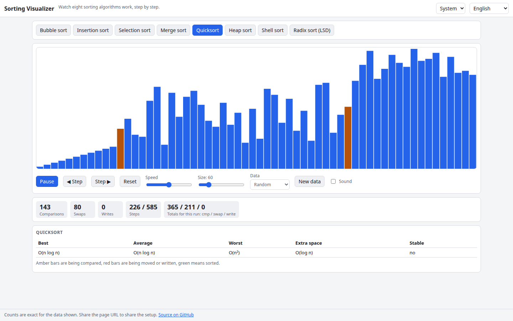

# Sorting Visualizer

Watch eight sorting algorithms (bubble, insertion, selection, merge, quick, heap, shell and radix) work on bars, with play/pause, single-stepping in both directions, speed and size controls, exact comparison/swap/write counters and optional sound. English and Ukrainian, light/dark theme, runs entirely in your browser.

**Try it:** https://hermes98761234.github.io/sorting-visualizer/

[](https://github.com/hermes98761234/sorting-visualizer/actions/workflows/deploy.yml)



## Features

- Bubble, insertion, selection, merge, quicksort (median of three), heap, Shell (Ciura gaps) and LSD radix sort
- Data patterns: random, nearly sorted, reversed, few unique; 5 to 300 elements
- Step forward and backward, replay, exponential speed slider (2 to 3000 operations per second)
- Live counters for comparisons, swaps and writes plus the totals for the whole run
- Complexity table (best/average/worst, extra space, stability) per algorithm
- Optional Web Audio sound: pitch follows the bar being touched
- Shareable setup via the URL hash (`#a=quick&n=60&p=random&s=3`), settings saved locally

## How it works

Each algorithm runs once on a copy of the data and records primitive operations (compare, swap, write with the old value). The UI replays them forwards and backwards, so stepping is exact and counters are real. Unit tests check that every algorithm sorts every pattern and size, that every event list is reversible, and textbook counts (bubble/insertion on sorted input need n-1 comparisons, selection n(n-1)/2, reversed input needs n(n-1)/2 swaps for bubble and insertion).

## Quick start

```
npm install
npm run dev
npm test
npm run build
```

## License

MIT, see [LICENSE](LICENSE).
